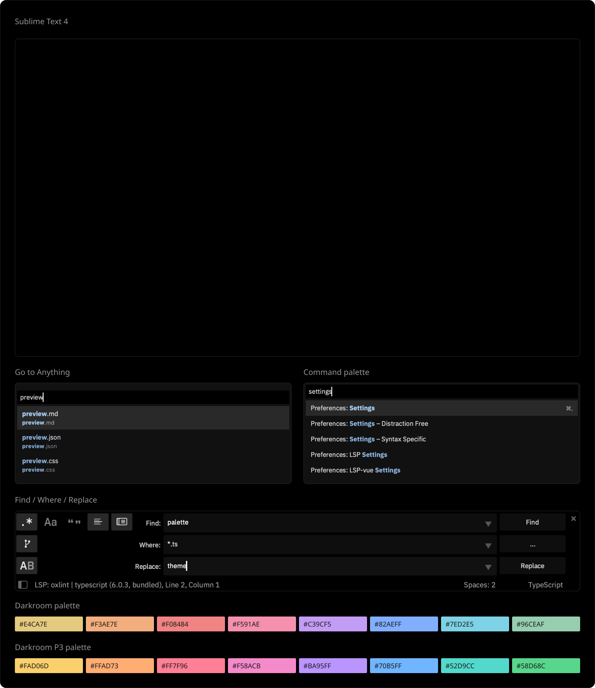

# Darkroom



## Install

Requires Sublime Text 4 **4197+** on **macOS**. Install
[IBM Plex Sans](https://github.com/IBM/plex) for the interface font.

Package Control submission is pending. Install from a checkout:

```sh
git clone https://github.com/pioug/sublime-darkroom.git
cd sublime-darkroom
bash scripts/install.sh
```

In the Command Palette (`⌘⇧P`), select **Darkroom** under both
**UI: Select Theme** and **UI: Select Color Scheme**.

For eight wide-gamut accents on Display P3 Macs, choose **Darkroom P3** under
**UI: Select Color Scheme**. It keeps the pure black background and neutral text.

For a standalone archive and release steps, see [RELEASING.md](RELEASING.md).

## License

[MIT](LICENSE) · Gilles Piou
